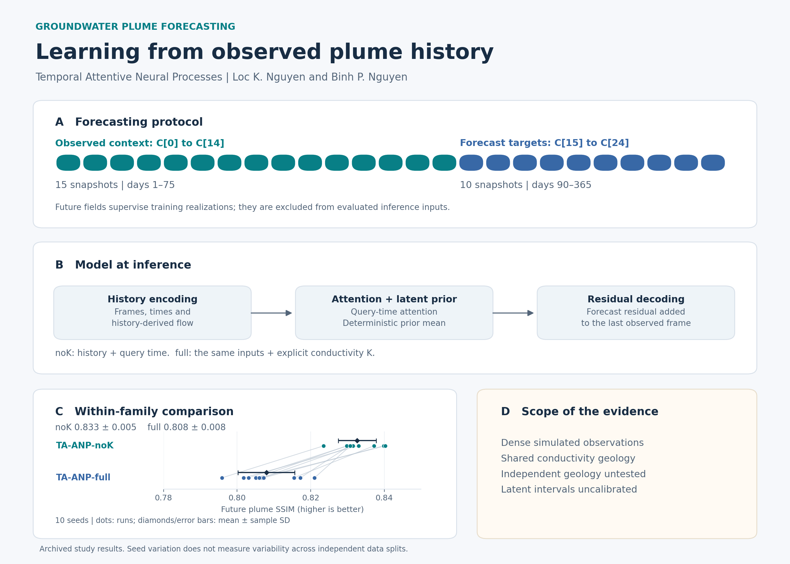
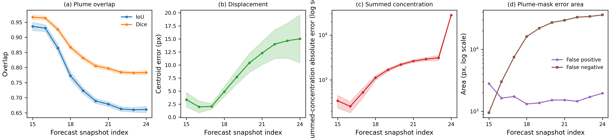
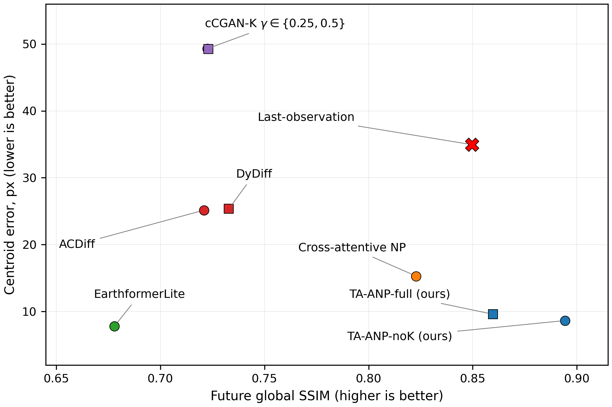

# Groundwater plume forecasting with TA-ANP

[](https://github.com/loc-k-nguyen/groundwater-plume-forecasting/actions/workflows/ci.yml)
[](LICENSE)
[](REPRODUCE.md)

[Reproduction guide](REPRODUCE.md) · [Evidence mapping](docs/PAPER_MAPPING.md) · [Software guide](docs/SOFTWARE_GUIDE.md) · [Citation](CITATION.cff)

Code and source-traceable summaries for **Observation-Conditioned Temporal Attentive Neural Processes for Long-Horizon Groundwater Plume Forecasting**, by Loc K. Nguyen and Binh P. Nguyen.

The paper was conditionally accepted to the ACML 2026 Journal Track. Formal acceptance by *Machine Learning* remains conditional on the conference presentation and completion of the final-manuscript requirements. Software version `acml-v15-2026-10-15-r1` corresponds to the current local v15 article and Supplementary. A software release is not evidence of a manuscript upload or final journal publication.



The overview uses the archived ten-seed results. Dots represent runs, paired lines join matching seed IDs, and diamonds with error bars show means and sample standard deviations. The SSIM axis displays 0.78–0.85. The schematic summarizes inference; it does not depict a new experiment or certify independent-geology transfer. [Figure sources and interpretation](docs/FIGURES.md).

## Research question

Can a dense observed concentration history forecast later plume fields, and how does adding hydraulic conductivity change the forecast? TA-ANP combines attentive neural-process components, a residual forecast anchor, history-derived flow features, and plume-specific losses. TA-ANP-noK receives concentration history and query time; TA-ANP-full also receives conductivity.

The protocol observes `C[0]` through `C[14]` (days 1–75) and predicts `C[15]` through `C[24]` (days 90–365). Future targets supervise training configurations. Future snapshots of an evaluated realization are excluded from inference inputs. This is forecasting beyond observed context, not extrapolation beyond the training target-time range.

Across ten seeds on the fixed split, the paper reports plume SSIM of `0.833 ± 0.005` for noK and `0.808 ± 0.008` for full. These results apply to the studied synthetic design. They do not establish that conductivity is physically unimportant, that sparse observations suffice, or that independent geology has been tested.

## Software at a glance

The package connects PyTorch forecasting models, plume-aware evaluation, seed-aligned statistical analysis and artifact-level provenance checks. Data-free tests exercise inference shapes, noK input invariance, CLI behavior, evidence integrity and output safety. Archived tables and aggregate figures are available for inspection without simulator fields.

| Start here | Purpose |
|---|---|
| [Reproduction guide](REPRODUCE.md) | Run CPU verification and rebuild summaries |
| [Software guide](docs/SOFTWARE_GUIDE.md) | Find models, evaluation tools and extension boundaries |
| [Paper mapping](docs/PAPER_MAPPING.md) | Trace manuscript claims to code and evidence |
| [Figure catalog](docs/FIGURES.md) | Understand the plots and their statistical units |
| [Security and restricted inputs](SECURITY.md) | Handle private data and trusted checkpoints |

## Quick start without the simulation data

Use Python 3.9. Install CPU PyTorch separately, then the tested analysis requirements:

```bash
python -m venv .venv
source .venv/bin/activate
python -m pip install torch==2.1.0 --index-url https://download.pytorch.org/whl/cpu
python -m pip install -r requirements-cpu-lock.txt
python scripts/check_release.py
python -m unittest discover -s tests -v
python scripts/validate_release_artifacts.py
python scripts/verify_revision_evidence.py
python scripts/reproduce_summaries.py --out-dir outputs/reproduction
python scripts/make_figures.py --out_dir outputs/reproduction/figures
python scripts/make_research_overview.py --out-dir outputs/reproduction/overview
python scripts/build_manifest.py --check
```

On Windows, activate with `.venv\Scripts\Activate.ps1`. These commands parse sources, check the manifest and evidence, run small synthetic CPU forward passes, recompute six seed-aligned tests and grouped-split statistics, aggregate archived diagnostic summaries, and regenerate two aggregate plots and the research overview. They do not train a model.

## Where to see passing checks

Open the repository's **Actions** tab, select **CPU reproducibility checks**, and open a completed run. Its Summary shows the conclusion; the **verify** job contains the individual commands and logs. The verification summary records the tested commit and the data-free checks completed for that run. Green checks certify these CPU checks, not restricted-data training or journal acceptance.

The badge refers to the remote default-branch workflow. Match the tested commit to the version you use; a later default-branch check may concern different code. For a paper or portfolio, link to [the fixed software version](https://github.com/loc-k-nguyen/groundwater-plume-forecasting/tree/acml-v15-2026-10-15-r1) as well as the repository overview.

## Diagnostic figures



Forecast-step diagnostics for TA-ANP-noK. Shaded bands show the standard deviation across seeds. These plots expose changes in overlap, location, summed concentration and detection errors as the horizon grows; the summed-concentration diagnostic is not a conservative mass-balance residual.



Global SSIM and centroid error describe different aspects of forecast quality. A static reference can score well on global similarity while missing plume movement. Reference models have different input regimes and training-target windows, so this figure does not isolate the effect of history. See the [figure catalog](docs/FIGURES.md) for source artifacts, seed accounting and limitations.

## What is reproducible here

| Included | Scope |
|---|---|
| TA-ANP model, training and prediction export | Requires separately authorized simulation fields and checkpoints for substantive runs |
| Cross-attentive NP and EarthformerLite models | Representative configurations and metrics; family-specific trainers are not included |
| cCGAN-K, ACDiff and DyDiff references | Configurations, metrics and the cCGAN data loader; complete trainers are not included |
| Statistical and summary analysis | Runs on the included lightweight artifacts on CPU |
| Fixed and conductivity-grouped splits | Preserved definitions, with explicit reuse and twin limitations |
| Screening, pairing and uncertainty evidence | Archived summaries, not reconstruction from omitted caches |

See [REPRODUCE.md](REPRODUCE.md) for commands and [docs/PAPER_MAPPING.md](docs/PAPER_MAPPING.md) for the manuscript mapping.

## Scientific limits

The main split is configuration-disjoint but reuses exact conductivity arrays. The conductivity-grouped split removes byte-identical reuse, yet 30 of 31 distinct test fields and all 15 validation fields have amplitude-rescaled training twins. It therefore does not test independent geology. TA-ANP-noK also retains geology information indirectly in its observed plume history.

The deterministic results use the latent prior mean. Archived latent samples are poorly calibrated: nominal 90% intervals cover about 39% of reference values. Screening removes two anomalous test snapshot pairs for selected within-family diagnostics; original unscreened results and the pairing evidence are retained. The grouped noK seed-0 rerun replaces an earlier smoke-resumed run, as recorded in the evidence. Other requested controls and fresh independent geology remain unperformed in this paper snapshot.

## Layout and availability

`src/` contains the models, loaders and metrics; `scripts/` contains entry points and verification; `configs/` contains representative run settings; `metadata/` contains fixed splits and audit evidence; `tables/` contains lightweight results; `tests/` contains CPU regressions; `docs/` records scope and provenance. `figures/` contains only aggregate plots. Generated outputs go under ignored `outputs/`.

Raw simulation fields, simulator assets and launch commands, checkpoints, full prediction caches, infrastructure, credentials, reviewer correspondence, manuscript drafts and full project history are excluded. Inspection of summaries is reproducible; complete end-to-end model reproduction is not possible from this repository alone. No access to restricted assets is implied.

## Citation and license

[CITATION.cff](CITATION.cff) describes the software and the associated unpublished manuscript without inventing a DOI, volume, pages or final acceptance. Paper author credit is distinct from software contribution credit.

Original study code is distributed under the owner-authorized [MIT license](LICENSE); the original BSD notice is retained in [docs/LICENSE-BSD-3-Clause-original.txt](docs/LICENSE-BSD-3-Clause-original.txt). Upstream libraries keep their own licenses. Neither license grants rights to excluded data or simulator assets. See [the changelog](CHANGELOG.md) for the bounded tooling changes.
